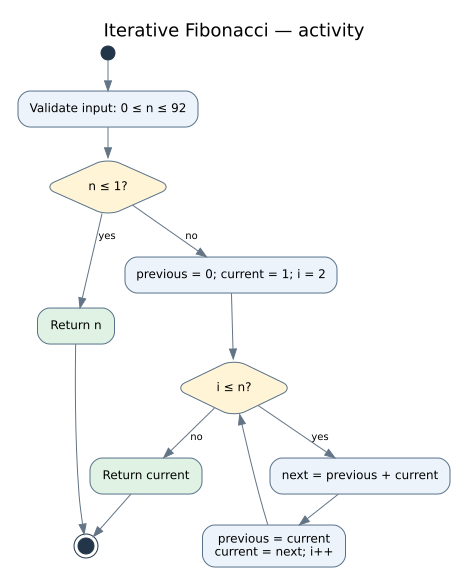
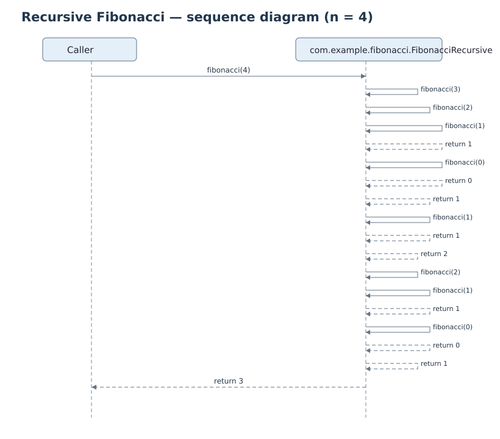
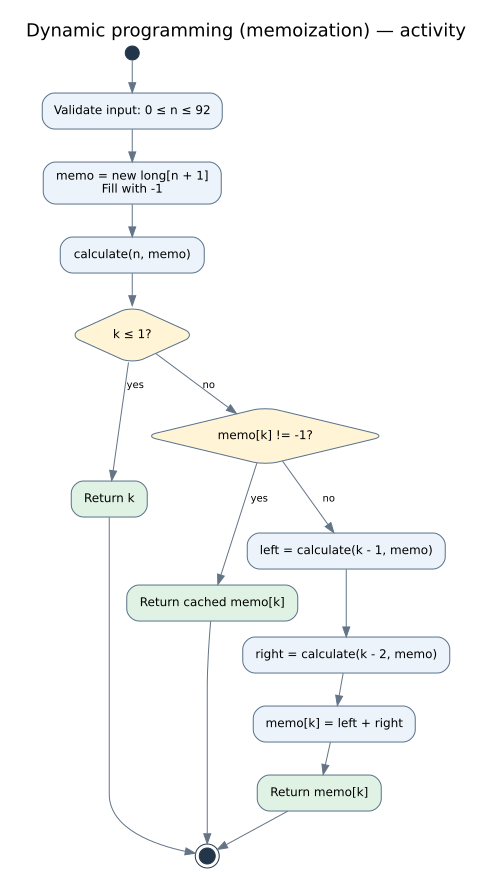

# Числа Фібоначчі — модуль 5

У цьому домашньому завданні я реалізував три способи обчислення чисел Фібоначчі на Java: за допомогою циклу, рекурсії та динамічного програмування. Мета — порівняти, як ці алгоритми працюють і скільки часу та пам'яті їм потрібно.

Послідовність починається з `0` і `1`, а кожне наступне число — це сума двох попередніх. Використовую нумерацію з нуля: `F(0) = 0`, `F(1) = 1`, `F(6) = 8`.

## Три способи розв'язання

**Ітераційний (`FibonacciIterative`)** — обчислює числа по черзі в циклі `for`. Зберігає лише два попередні значення та наступне число.

**Рекурсивний (`FibonacciRecursive`)** — метод викликає сам себе для `n - 1` і `n - 2`, поки не дійде до `0` або `1`. Код короткий, але однакові значення обчислюються багато разів.

**Динамічне програмування (`FibonacciDynamicProgramming`)** — теж використовує рекурсію, але зберігає готові результати в масиві `memo`. Якщо значення вже обчислене, метод бере його з масиву, а не рахує повторно.

## Часова та просторова складність

| Спосіб | Часова складність | Просторова складність |
| --- | --- | --- |
| Ітераційний | `O(n)` | `O(1)` |
| Рекурсивний | `O(2^n)` | `O(n)` |
| Динамічне програмування | `O(n)` | `O(n)` |

Ітераційний алгоритм проходить цикл приблизно `n` разів, але кількість додаткових змінних не залежить від `n`.

У звичайній рекурсії кількість викликів швидко зростає через повторні обчислення. Пам'ять `O(n)` потрібна для стеку вкладених викликів.

У динамічному програмуванні кожне число обчислюється один раз, тому час `O(n)`. Проте потрібно зберігати масив результатів і стек викликів, тому пам'ять теж `O(n)`.

У програмі використовую тип `long` та значення `n` від `0` до `92`. Більші числа не поміщаються в `long`. При цьому рекурсивний спосіб без кешування практично підходить лише для невеликих `n`, бо працює повільно.

## UML-діаграми

Для кожного алгоритму підготував окрему UML-діаграму. У папці `diagrams` є готові зображення `.svg` та файли `.puml`, які можна редагувати.

**Ітераційний метод — діаграма активності.** Показує цикл, перевірку умови та оновлення значень.



**Рекурсивний метод — діаграма послідовності.** Показує вкладені виклики `fibonacci(4)` і повернення результату.



**Динамічне програмування — діаграма активності.** Показує перевірку масиву `memo` та збереження нового результату.



## Як запустити

Проєкт можна відкрити в IntelliJ IDEA та запустити метод `main()` у класі `Main.java` з пакета `com.example.fibonacci`.

Або запустити через PowerShell із кореневої папки проєкту:

```powershell
New-Item -ItemType Directory -Force out | Out-Null
$files = Get-ChildItem "src/main/java/com/example/fibonacci" -Filter "*.java" | ForEach-Object { $_.FullName }
javac -encoding UTF-8 -d out $files
java -cp out com.example.fibonacci.Main
```

Результат для `n = 6`:

```text
n = 6
Iterative: 8
Recursive: 8
Dynamic programming: 8
All checks passed!
```

У `Main.java` я також додав прості перевірки для `n = 0, 1, 2, 6, 10, 20`. Усі три методи повинні повертати однакові правильні результати.
